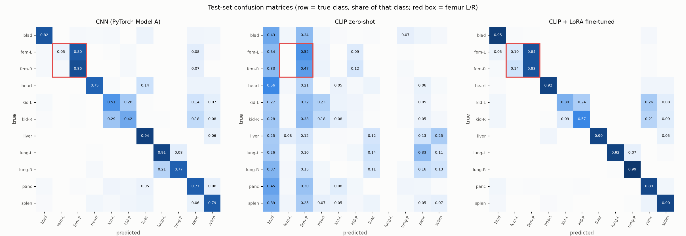
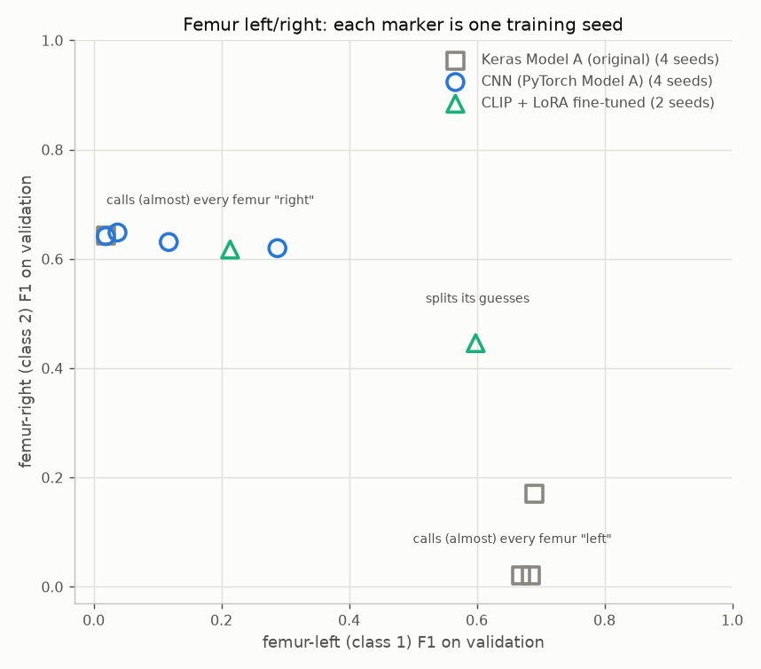
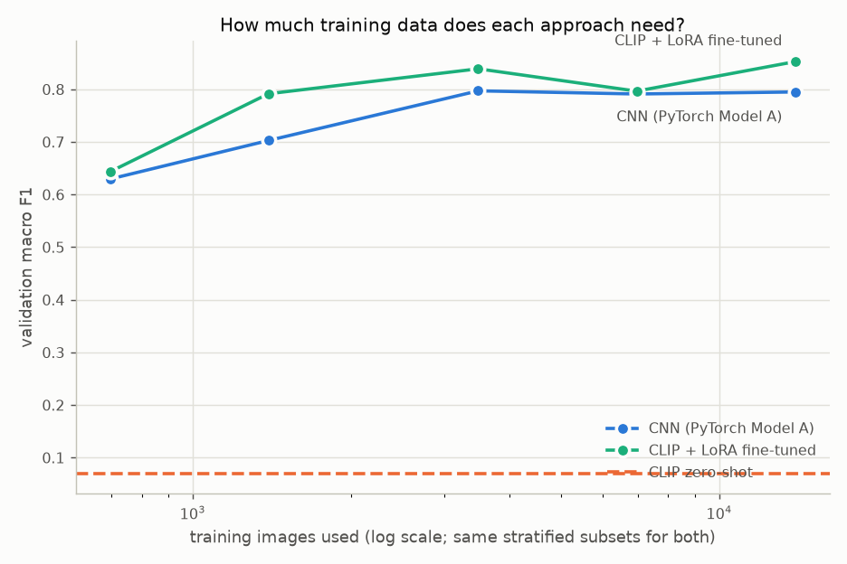
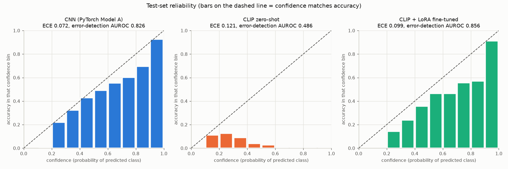

# Small CNN vs. fine-tuned vision-language model on 64×64 CT organ images

**Question.** For small-sample, low-resolution medical image classification, does fine-tuning a
pretrained vision-language foundation model beat a small specialized CNN ("Model A") trained from
scratch on the same data?

**Data.** OrganSMNIST 64×64: 11 abdominal organs, sagittal CT slices, 13,932 train / 2,452 val /
8,827 test images.

**Contenders.** Three models, all run on the same splits, scored by the same metric code, with the
test set scored once each:
1. **CNN**: Model A (286,219 parameters), ported from Keras to PyTorch and trained from scratch.
2. **CLIP zero-shot**: `openai/clip-vit-base-patch32` (151M parameters), no training on our data.
3. **CLIP + LoRA**: the same CLIP, fine-tuned with LoRA (983,040 trained parameters, 0.65%).

## The answer, up front

**Yes, the fine-tuned foundation model wins on the headline metrics, and by more than noise.
It costs far more compute, and it does not fix the CNN's known class 1/2 problem.**

| test set (8,827 images, scored once) | accuracy | macro F1 |
|---|---|---|
| CNN (PyTorch Model A) | 0.7416 | 0.6745 |
| CLIP zero-shot | 0.1126 | 0.0731 |
| **CLIP + LoRA fine-tuned** | **0.8014** | **0.7409** |
| *(reference: original Keras Model A)* | *0.7339* | *0.6840* |

- **The winner is fine-tuned CLIP**, by +6.0 accuracy points and +0.066 macro F1 on test.
  - On validation it is also ahead of all 4 CNN seeds. Over the two CLIP seeds that were run (42 and 7; see [limitations](#simplifications-and-limitations-what-was-done-the-simple-way)), mean validation macro F1 is 0.865 vs 0.802 for the CNN's four seeds. Even the lower CLIP seed (0.853) beats the best CNN seed (0.818).
  - It has a higher test F1 on 9 of 11 classes. The other two (femur-right, kidney-left) are at most
    0.011 lower.
- **Fine-tuning does all the work.** Out of the box, CLIP is at chance level (accuracy 0.11). Its web
  pre-training knows nothing useful about 64×64 sagittal CT crops. It only becomes useful after
  training on our labelled images, though as few as 10% of them already match the CNN.
- **Neither model can tell the left femur from the right femur.**
  - Both find femurs reliably, but pick the side correctly only about 50% of the time (CNN 0.53,
    CLIP 0.49 on test).
  - A model-free pixel test is also at 0.50 for femurs, but 0.65 for kidneys and 0.87 for lungs.
  - So the "bistable class 1/2 confusion" is most likely **a property of the data**, not of the CNN.
    See [the femur section](#the-class-12-femur-question).
- **The price.** On the same laptop GPU, CLIP needed:
  - **47× the training time** (39 min vs 50 s);
  - **4.4× the peak GPU memory**;
  - **73× the test-time inference time**.

  In return, CLIP needs **about 10× less labelled data** to reach the CNN's level: with 1,392 training
  images it matches what the CNN reaches with all 13,932.
- **Calibration is a split decision.**
  - The CNN's confidence numbers are more honest: lower calibration error, ECE 0.072 vs 0.099. CLIP
    is over-confident.
  - CLIP's confidence is better at flagging its own mistakes: error-detection AUROC 0.856 vs 0.826.

## Folder layout

```
data/organsmnist_64.npz        the dataset (public OrganSMNIST 64x64 file, MD5-checked)
common.py                      data loading, class names, all metric code (used by everything)

cnn/                           Approach 1 - the CNN
  model_a.py                   the network (same layers as the Keras original)
  train_cnn.py                 training: Phase 1 recipe, early stopping on validation loss
  score_test.py                the one test-set evaluation
foundation_model/              Approach 2 - CLIP
  clip_setup.py                load CLIP, turn 64x64 gray images into CLIP input, class prompts
  zero_shot.py                 CLIP with no training (reference point)
  finetune_lora.py             LoRA fine-tuning, plain PyTorch loop
  score_test.py                the one test-set evaluation
  langchain_pipeline.py        the finished model wrapped in a LangChain chain (inference only)

compare.py                     builds every comparison table/figure from saved results (runs no model)
run_everything.sh              all commands in the right order
requirements.txt               pure PyTorch stack, exact versions

results/
  keras_reference/             what the ORIGINAL Keras model scored (kept as data; Keras code is gone)
  cnn/                         one JSON per training run + the test result + test probabilities
  foundation_model/            same for CLIP (zero-shot, fine-tuning runs, test, LangChain check)
  comparison/                  comparison.json, summary.md (all tables), 4 figures
logs/                          console output of the runs (not in git)
checkpoints/                   trained weights (created by the training scripts; not in git)
previous_work/                 Phase 1 & 2 reports, slides, figures and CSV logs from the Keras era
```

## Data

- **File:** `data/organsmnist_64.npz` (not in this repo, 86 MB). Download it from
  `https://zenodo.org/records/10519652/files/organsmnist_64.npz` into `data/`.
- **It is the real OrganSMNIST:** its MD5 is `53a6d115339d874c25e309a994ff46d3`, exactly the
  checksum the official MedMNIST package publishes for `organsmnist_64.npz`
  ([MedMNIST](https://medmnist.com/), CC BY 4.0, Zenodo record 10519652).
- **Class names are confirmed:** they come from the official MedMNIST label map, so they are no longer
  the "unverified hypothesis" of the Phase 1 notebook.
  - 0 bladder, 1 femur-left, 2 femur-right, 3 heart, 4 kidney-left, 5 kidney-right, 6 liver,
    7 lung-left, 8 lung-right, 9 pancreas, 10 spleen.
- **Splits are used as-is.** They come from different CT scans (MedMNIST: 115 / 16 / 70 scans).
  - train 13,932, val 2,452, test 8,827, no duplicate images in any split.
  - The images are crops from sagittal (side-view) slices, grayscale, 64×64.

## How to run

```bash
mkdir -p data && curl -L -o data/organsmnist_64.npz \n  "https://zenodo.org/records/10519652/files/organsmnist_64.npz?download=1"
python -m venv .venv
.venv/Scripts/python -m pip install torch==2.8.0 --index-url https://download.pytorch.org/whl/cu128
.venv/Scripts/python -m pip install -r requirements.txt
bash run_everything.sh          # or run its lines one by one; every command is run from this folder
```

The CLIP model (~600 MB) is downloaded once to the Hugging Face cache; set the `HF_HOME`
environment variable to put it elsewhere. Total run time on an NVIDIA MX570 laptop GPU is about
4–5 hours, almost all of it CLIP fine-tuning.

---

## Part 1 - Migrating Model A from Keras to PyTorch

### Step 1: the Keras reference, measured before anything was changed

The original Keras checkpoint `model_a_baseline_best.keras` (seed 42) was scored on the real data
with TensorFlow 2.21 / Keras 3.15.1. This ran in a throwaway environment outside the project.

| | val accuracy | val macro F1 | test accuracy | test macro F1 |
|---|---|---|---|---|
| documented in Phase 1 | 0.8907 | 0.8053 | 0.7339 | 0.684 |
| re-measured | 0.8907 | 0.8053 | 0.7339 | 0.6840 |

- **Exact match** on all four numbers. Test macro precision (0.7007) and recall (0.6857) match too.
- The three Phase 2 seed checkpoints (7, 123, 2024) also reproduce their logged validation numbers.
- Everything is saved in `results/keras_reference/`:
  - `keras_reference.json`: metrics, confusion matrices, calibration, checkpoint MD5s, versions;
  - `keras_seed42_probabilities.npz`: the raw val/test probabilities.

### Step 2: PyTorch Model A, checked two ways

**(a) Same architecture, proven, not assumed.** The trained Keras weights were copied into the
PyTorch model and its predictions compared with Keras's:

- the same predicted class for 100% of val and test images;
- the largest probability difference was 1.4e-6, i.e. ordinary float32 rounding.

PyTorch Model A is therefore the same mathematical function, not just a network with the same
parameter count (286,219).

One trap found on the way: PyTorch on newer NVIDIA GPUs runs convolutions in reduced-precision
"TF32" mode by default. That made the difference 4e-4 instead of 1e-6, so the CNN code turns TF32
off (`use_full_float32()` in `cnn/model_a.py`). The check itself lives on as
`results/cnn/keras_weight_port_check.json`.

**(b) Same recipe, retrained from scratch.**
- Adam with lr 1e-3, batch 64, at most 30 epochs.
- Early stopping on validation loss with patience 5, keeping the best epoch.
- Inputs scaled to [0, 1].
- Keras-style Glorot-uniform initialization, and Keras's Adam epsilon of 1e-7.
- The same four seeds as Phase 1/2, scored on validation.

| seed | Keras val acc | Keras val macro F1 | PyTorch val acc | PyTorch val macro F1 |
|---|---|---|---|---|
| 42 | 0.8907 | 0.8053 | 0.8785 | 0.7950 |
| 7 | 0.8850 | 0.7973 | 0.8801 | 0.8181 |
| 123 | 0.8789 | 0.7973 | 0.8707 | 0.7940 |
| 2024 | 0.8874 | 0.8169 | 0.8895 | 0.8025 |
| **mean** | **0.8855** | **0.8042** | **0.8797** | **0.8024** |

| test (seed 42, scored once) | accuracy | macro F1 |
|---|---|---|
| Keras Model A | 0.7339 | 0.6840 |
| PyTorch Model A | 0.7416 | 0.6745 |

**Discrepancies, stated plainly:**
- **Macro F1:** PyTorch matches Keras on average (0.8024 vs 0.8042 over four seeds), well inside
  Keras's own seed-to-seed range of 0.797–0.817.
- **Validation accuracy:** consistently a little lower, by 0.006 on average. Seed 42 (0.8785) and
  seed 123 (0.8707) fall just below Keras's lowest seed (0.8789).
- **Test:** accuracy is 0.008 higher and macro F1 0.010 lower. Almost all of the F1 gap is the
  femur side flip described below. Keras seed 42 happened to call femurs "left" (class 1/2 test F1
  0.56/0.25); PyTorch seed 42 calls them "right" (0.10/0.63).
- **Seeds don't carry over:** the same seed number gives different random numbers in TensorFlow and
  PyTorch, so seed 42 is not "the same run" in both. Only the distributions are comparable.
- **Side preference differs:** Keras committed to "left" in 3 of 4 seeds, while PyTorch committed to
  "right" in all 4 (seed 7 only partly). Four seeds can't tell a coin flip from a framework-specific
  lean.
- **Determinism:** retraining seed 42 gives a bit-identical checkpoint (same MD5), so the PyTorch runs
  are fully reproducible.
- **Remaining known difference:** Keras's Adam applies its epsilon in a slightly different place in
  the update formula than PyTorch's. This was not replicated, and it only matters in the first few
  steps.

The port counts as validated: the architecture is identical, and the retrained recipe lands inside
the original model's own seed-to-seed noise.

### Step 3: Keras removed

- **Deleted:**
  - all 23 `.keras` checkpoint files (84 MB);
  - the four Keras notebooks (`organ_cnn_project.ipynb` and three Phase 2 notebooks);
  - the two temporary scripts that read Keras files;
  - the `pip install tensorflow` instruction.
- **Moved, not deleted:** the non-code Phase 1/2 record (technical report, slides, figures, CSV logs)
  is in `previous_work/`. The Phase 2 charter there was renamed so this is the only README.
- **What remains of Keras:** only data in `results/keras_reference/`, as numbers and probabilities,
  not code.
- **Nothing is lost:** the deleted notebooks and checkpoints are still in the upstream git history
  (`github.com/anchal-chin/ddp-project`, commit `8738336`).

---

## Part 2 - The comparison

### How CLIP classifies (and why it counts as a vision-language model)

CLIP has two encoders, one for images and one for text. Each turns its input into a 512-number
vector. In pre-training (400M web image–caption pairs), CLIP learned to make an image's vector point
the same way as the vector of a caption that describes it.

To classify a CT crop:
1. Write one sentence per class, e.g. *"a grayscale medical image of the left kidney."*
2. Encode all 11 sentences.
3. Pick the sentence whose vector is most similar to the image's vector.

There is no new output layer: the class *names*, read by the text encoder, are the classifier.

**LoRA** freezes all 151M original weights. Next to each attention projection (query, key, value,
output) in both encoders, it adds a small trainable correction `B·A` of rank 8. The correction starts
at zero, so training starts exactly from zero-shot CLIP; epoch 0 in the logs confirms val accuracy
0.1154 = zero-shot. Only 983,040 numbers are trained.

### What was held equal, and what could not be

| | CNN | CLIP + LoRA |
|---|---|---|
| data | same files, same splits | same |
| learning-curve subsets | same per-class random subsets (seed 42) | same |
| metric code | `common.compute_metrics` (sklearn) | same |
| model selection | lowest validation loss, early stopping, restore best epoch | same rule |
| test set | scored once, model fixed in advance (seed 42, full data) | same |
| input | 64×64×1, scaled to [0,1] | upsampled to 224×224, gray copied to RGB, CLIP normalization (CLIP only accepts this) |
| optimizer | Adam lr 1e-3 (Phase 1 recipe) | AdamW lr 2e-4 (a standard LoRA value, not tuned) |
| batch / epochs | 64 / max 30, patience 5 | 16 / max 10, patience 3 (2 GB GPU memory; one CLIP epoch ≈ 133 CNN epochs) |
| tuning effort | recipe chosen over 10 Phase 1/2 experiments on val | only the prompt sentence was chosen (on val); LoRA settings not tuned |

If anything, the CNN had the more tuned recipe.

**Why CLIP and not a generative model.** The laptop GPU (NVIDIA MX570) has 2 GB, with about 1.6 GB
actually free.
- **Generative VLMs:** even the smallest generative vision-language models (~250M+ parameters) need
  about 1 GB for their weights alone before any training memory.
- **CLIP at batch 32:** it already reached the card's 2 GB limit (measured 1,927 MiB). At that point
  the driver silently moves memory to system RAM and training slows to a crawl.
- **CLIP at batch 16:** it peaks at 1.26 GB, so that is what was used.

### Results: headline

| approach | val acc | val macro F1 | test acc | test macro F1 | test femur side accuracy |
|---|---|---|---|---|---|
| Keras Model A (original, reference) | 0.8907 | 0.8053 | 0.7339 | 0.6840 | 0.499 |
| CNN (PyTorch Model A) | 0.8785 | 0.7950 | 0.7416 | 0.6745 | 0.529 |
| CLIP zero-shot | 0.1154 | 0.0701 | 0.1126 | 0.0731 | 0.481 |
| **CLIP + LoRA fine-tuned** | **0.9225** | **0.8526** | **0.8014** | **0.7409** | 0.492 |

| test F1 per class | Keras Model A | CNN | CLIP zero-shot | CLIP + LoRA |
|---|---|---|---|---|
| 0 bladder | 0.849 | 0.855 | 0.178 | **0.890** |
| 1 femur-left | 0.561 | 0.097 | 0.000 | 0.158 |
| 2 femur-right | 0.250 | **0.630** | 0.155 | 0.619 |
| 3 heart | 0.770 | 0.794 | 0.006 | **0.863** |
| 4 kidney-left | 0.511 | **0.525** | 0.064 | 0.517 |
| 5 kidney-right | 0.439 | 0.461 | 0.054 | **0.619** |
| 6 liver | 0.909 | 0.913 | 0.203 | **0.949** |
| 7 lung-left | 0.890 | 0.843 | 0.000 | **0.954** |
| 8 lung-right | 0.885 | 0.832 | 0.023 | **0.955** |
| 9 pancreas | 0.741 | 0.746 | 0.045 | **0.808** |
| 10 spleen | 0.718 | 0.724 | 0.075 | **0.816** |
| *macro F1 with the two femur classes merged* | *0.760* | *0.760* | *0.090* | ***0.833*** |

**Is the gap real?** On the same 8,827 test images:
- **Accuracy (McNemar test):** CLIP is right where the CNN is wrong 1,113 times, the reverse 585
  times; p = 5e-38.
- **Macro F1 (bootstrap):** the difference is +0.066, with a 95% interval of [+0.055, +0.078] from
  resampling test images 1,000 times.
- **Caveat:** both calculations treat images as independent. They aren't: many slices come from the
  same 70 test patients. The true uncertainty is therefore larger than these intervals, but a
  1,113-vs-585 split is very unlikely to flip.
- **Validation agrees:** CLIP leads there too, beyond seed-to-seed noise (see the seed table below).

**Both models get many of the same images wrong.** 51% of the CNN's test errors are also CLIP errors.
The worst shared weaknesses on test are:
- femur side;
- kidney side;
- kidneys mistaken for pancreas.

**Both drop from validation to test by a similar amount:** −0.137 accuracy for the CNN, −0.121 for
CLIP, −0.157 for the Keras original. A drop that every model shares points to the test scans being
harder or different from the 16 validation scans, not to over-fitting by one approach. Validation
numbers from only 16 patients are optimistic for every model here.



### The class 1/2 (femur) question

Classes 1 and 2 are **femur-left** and **femur-right**. In Phase 2, the CNN's "bistable" confusion
between them was the project's central finding: depending on the seed, it calls nearly all femurs
"left" or nearly all "right".

**Does the foundation model show the same thing? Yes.**

Validation, one row per training run:

| seed | approach | val macro F1 | femur-left F1 | femur-right F1 | femurs found | side accuracy | share of femur calls = "left" |
|---|---|---|---|---|---|---|---|
| 42 | Keras Model A | 0.805 | 0.684 | 0.021 | 0.995 | 0.525 | 0.995 |
| 7 | Keras Model A | 0.797 | 0.019 | 0.643 | 0.960 | 0.482 | 0.016 |
| 123 | Keras Model A | 0.797 | 0.669 | 0.020 | 1.000 | 0.513 | 0.980 |
| 2024 | Keras Model A | 0.817 | 0.690 | 0.170 | 0.985 | 0.556 | 0.944 |
| 42 | CNN (PyTorch) | 0.795 | 0.037 | 0.648 | 0.995 | 0.485 | 0.015 |
| 7 | CNN (PyTorch) | 0.818 | 0.288 | 0.620 | 0.980 | 0.508 | 0.179 |
| 123 | CNN (PyTorch) | 0.794 | 0.118 | 0.631 | 0.995 | 0.480 | 0.071 |
| 2024 | CNN (PyTorch) | 0.803 | 0.019 | 0.642 | 0.990 | 0.482 | 0.005 |
| 42 | CLIP + LoRA | 0.853 | 0.214 | 0.617 | 1.000 | 0.487 | 0.131 |
| 7 | CLIP + LoRA | 0.876 | 0.598 | 0.446 | 1.000 | 0.538 | 0.643 |

On test, both models spread their probability almost evenly over the two sides:

| test, true femur images | mean P(left) | mean P(right) | mean P(either femur) | confidence when side right | when side wrong | on all correct predictions |
|---|---|---|---|---|---|---|
| Keras Model A | 0.449 | 0.412 | 0.861 | 0.549 | 0.545 | 0.899 |
| CNN (PyTorch) | 0.366 | 0.478 | 0.844 | 0.537 | 0.532 | 0.877 |
| CLIP + LoRA | 0.435 | 0.523 | 0.957 | 0.545 | 0.546 | 0.941 |

- **Every model and every seed finds femurs** (96–100% of validation femurs predicted as *some*
  femur).
- **Every one gets the side right only about half the time** (side accuracy 0.48–0.56).
- **CLIP is no exception.** It is a 150M-parameter transformer pre-trained on 400M images, completely
  unlike the CNN, yet it has the same blind spot.
- **Every model is unsure about the side, and says so.** On test, a femur prediction has confidence
  about 0.53–0.55, the same whether the side is right or wrong, against 0.88–0.94 for typical correct
  predictions. The models have learned "femur, side unknown"; a small tilt in that ~50/50 split
  decides the final answer.
- **"Always the same side" is just one way to break the tie.** CNN seeds and CLIP seed 42 send most
  femurs to one side; CLIP seed 7 splits them per image (34 errors one way, 58 the other). Either way
  the side is right about half the time.
- **This also blurs macro F1.** A model that splits its femur guesses earns about 0.5 F1 on *both*
  classes. One that always says "right" earns about 0.65 + 0.02. So part of the seed-to-seed macro-F1
  spread is the coin flip, not skill. That is why the femurs-merged score in the table above is a
  fairer view of real ability.

**A test that involves no model at all.** For every validation image of a left/right pair, find the
single most similar training image of that pair, pixel by pixel, and copy its label:

| organ pair | val images | side accuracy (0.5 = no information) |
|---|---|---|
| femur-left vs femur-right | 199 | **0.503** |
| kidney-left vs kidney-right | 299 | 0.652 |
| lung-left vs lung-right | 536 | 0.873 |

**Conclusion: the femur side is (almost certainly) not in the images.**

The anatomy explains why. The body is mirror-symmetric across its middle sagittal plane. A sagittal
slice through the left femur and one through the right femur are mirror partners across that plane,
and mirroring across it does not flip the slice itself. So the two crops look the same.

Kidneys and lungs have asymmetric neighbours (left kidney beside the spleen, right kidney beside the
liver; the heart sits on the left), so their side *is* partly visible. The femur sits between
symmetric thigh muscles.

The "bistability" is then simply what any classifier does with two labels it cannot tell apart: it
breaks the tie in one direction, and which direction depends on the random seed. Two completely
different architectures and a model-free test agree, so this is very likely a property of the data,
not of the CNN or its training. It is not proven: a model could in principle find a subtle cue that
none of these did.

**What would actually fix it** is information the 64×64 crop does not contain, such as the slice's
left/right position in the CT volume. Alternatively, merge the two femur classes. With them merged,
test macro F1 rises to 0.760 for the CNN (from 0.675) and 0.833 for CLIP (from 0.741).



### How much training data does each approach need?

Both approaches were retrained (seed 42) on 5%, 10%, 25% and 50% of the training set. Each run
used the *same* per-class random subset for both models and the same selection rule, and was scored
on validation only.

| training images | CNN val macro F1 | CLIP + LoRA val macro F1 | CNN train time | CLIP + LoRA train time |
|---|---|---|---|---|
| 697 (5%, ~63 per class) | 0.630 | 0.644 | 8 s | 186 s |
| 1,392 (10%) | 0.703 | **0.792** | 9 s | 433 s |
| 3,484 (25%) | **0.797** | 0.839 | 20 s | 706 s |
| 6,966 (50%) | 0.791 | 0.797 | 27 s | 836 s |
| 13,932 (100%) | 0.795 | 0.853 | 50 s | 2,334 s |

- **The CNN plateaus at about 25% of the data** (3,484 images, ~0.79–0.80). Doubling or quadrupling
  the data after that changes nothing beyond its seed-to-seed noise (its four full-data seeds span
  0.794–0.818).
- **CLIP + LoRA reaches the CNN's full-data level with 10% of the data** (1,392 images): 0.792 vs the
  CNN's 0.795 with all 13,932. That is roughly 10× less data for the same score, and the clearest
  practical argument for the pre-trained model in a small-data setting. At 25% it is already well
  above the CNN's best.
- **With almost no data (697 images) they are level** (0.64 vs 0.63). Too few examples for either.
- **CLIP's curve is noisy.**
  - The 50% run (0.797) scored below the 25% run (0.839). Its validation loss jumped around between
    epochs (0.27 → 0.29 → 0.42 → 0.28), and the lowest-validation-loss rule picked epoch 2, when a
    later epoch had higher accuracy.
  - One seed per point can't separate this from noise. The overall shape (fast early gains, ahead of
    the CNN from 10% on) is clear; individual neighbouring points are not.
- **Femur side accuracy stays at 0.43–0.53 at every data size for both models.** More data never helps
  with the left/right femur question, which is what you would expect if the information isn't in
  the images.
- **Epoch caps:** the CNN's 5% run used all 30 epochs (best at 27), so it might have gained slightly
  with more. Every CLIP run stopped by early stopping or had its best epoch before the cap.



### Compute cost (NVIDIA MX570 laptop GPU, 2 GB, seed 42, full training set)

| | CNN | CLIP zero-shot | CLIP + LoRA |
|---|---|---|---|
| total parameters | 286,219 | 151,277,313 | 152,260,353 |
| trained parameters | 286,219 | 0 | 983,040 |
| epochs run (best) | 20 (15) | - | 7 (4) |
| training time | 50 s | 0 | 2,334 s (39 min) |
| time per epoch | 2.5 s | - | 333 s |
| peak GPU memory | 286 MB | - | 1,265 MB |
| test inference (8,827 images) | 0.9 s | 47 s | 65 s |
| saved weights | 1.1 MB | 605 MB (downloaded) | 3.8 MB adapter + the 605 MB base |

Fine-tuned inference (65 s) is slower than zero-shot (47 s) because the LoRA corrections are applied
as extra small matrix multiplications. Merging them into the base weights would remove that
overhead; this was not done, to keep the code simple.

### Calibration: does low confidence predict wrong answers?

"Confidence" is the probability a model gives to the class it picks.

| test set | accuracy | mean confidence | ECE (lower = better) | error-detection AUROC (higher = better) | accuracy of the 10% least confident | accuracy of the other 90% |
|---|---|---|---|---|---|---|
| Keras Model A | 0.7339 | 0.8366 | 0.1027 | 0.8353 | 0.362 | 0.775 |
| CNN | 0.7416 | 0.8132 | 0.0717 | 0.8264 | 0.360 | 0.784 |
| CLIP zero-shot | 0.1126 | 0.2334 | 0.1208 | 0.4861 | 0.112 | 0.113 |
| CLIP + LoRA | 0.8014 | 0.9009 | 0.0995 | 0.8562 | 0.421 | 0.844 |

- **Is a stated confidence trustworthy?**
  - The **CNN is better calibrated** (ECE 0.072 vs 0.099): when it says 80% it is right closer to
    80% of the time.
  - Both are over-confident on test, CLIP more so (mean confidence 0.90 vs accuracy 0.80).
  - Part of this is the val→test shift. On validation both were well calibrated (ECE 0.016 CNN,
    0.019 CLIP).
- **Can I use confidence to flag likely mistakes?**
  - **CLIP is better at this** (AUROC 0.856 vs 0.826): its least-confident predictions are where its
    errors concentrate.
  - For both models, the least-confident 10% are right only 36–42% of the time, vs 78–84% for the
    rest.
  - So low confidence does reliably flag wrong answers for both, a bit more sharply for CLIP.
- **Zero-shot confidence is meaningless** (AUROC 0.49 = coin flip).
- **The femur cases matter here too.** On true femur images, both models give an almost even
  probability split between "left" and "right". The mean confidence of a femur prediction is about
  0.53–0.55, the same whether the side is right or wrong. (Typical correct predictions sit at
  0.88–0.94.)
  - So confidence correctly says "this is a coin flip" for every femur.
  - But it cannot say *which* femur predictions are wrong. Nothing can, if the side is not in the
    image.



### The LangChain wrapper

`foundation_model/langchain_pipeline.py` wraps the finished fine-tuned model as a three-step chain:

```
PromptTemplate("a grayscale medical image of the {organ}.") -> 11 class sentences
  | fine-tuned CLIP (images + sentences -> probabilities)
  | parser (probabilities -> organ name, confidence, one-line answer)
```

- **It changes nothing:** run over all 8,827 test images, it agrees with the plain-PyTorch
  predictions on 100% of them, with an identical maximum probability difference of 0.
- **Example output:** `Predicted organ: kidney-right (class 5), confidence 1.00`.

LangChain's LLM classes assume "text in, text out", and CLIP does not generate text. So the model
step is a `RunnableLambda`, LangChain's standard way to put any Python function into a chain. It is
used only for inference; training does not touch LangChain.

---

## Verdict

**Fine-tuned CLIP is the better classifier on this data:**
- +6.0 test accuracy points and +0.066 test macro F1, statistically clear;
- better on almost every organ;
- better at flagging its own mistakes.

**The specialized CNN is the better deal on cost:**
- 50 seconds of training and 1 MB of weights, against 39 minutes and a 605 MB base model;
- better calibrated probabilities.

**The most interesting result is the femur problem.** It is not a CNN bug: a completely different,
much larger, pre-trained model has exactly the same blind spot, and a model-free pixel test agrees.
The left/right femur label is effectively not recoverable from these 64×64 sagittal crops. Any
further tuning aimed at "fixing the bistability" (as Phase 2 attempted) is unlikely to work without
extra information.

## Simplifications and limitations (what was done the simple way)

- **One foundation model.** General-purpose CLIP ViT-B/32 only. Medical CLIPs (BiomedCLIP,
  PubMedCLIP) or a generative VLM might do better zero-shot; they were out of scope or out of GPU
  memory.
- **No hyperparameter search for LoRA.** Rank, learning rate and target layers are standard values,
  not tuned. A tuned CLIP could only widen its lead; a better-tuned CNN would need to gain 0.066 test
  macro F1 to catch up.
- **Upsampling.** 64×64 images are stretched to 224×224 for CLIP (bicubic). CLIP never sees more
  detail than the CNN; it just sees bigger pixels.
- **Uncertainty.**
  - Test set: one seed per approach.
  - Validation: four seeds for the CNN, **two for CLIP (42 and 7)**. CLIP seeds 123 and 2024 were
    planned and started, but stopped by hand: the laptop switched to battery mid-run, each CLIP
    seed takes 40–60 min, and the battery would not have lasted (partial log kept as
    `logs/finetune_seed123_STOPPED_on_battery_incomplete.log`). To add them on mains power, run
    `python -m foundation_model.finetune_lora --seed 123` (and `--seed 2024`), then `python compare.py`.
    They only affect the validation seed tables, not the test results.
  - Learning curve: one seed per data size.
  - Significance tests treat images as independent (they aren't; same patients), so the intervals
    are too narrow.
- **ECE uses 10 equal-width bins,** the simplest standard version.
- **Seeds are framework-specific.** "Seed 42" in Keras and PyTorch are different random streams.
- **Adam epsilon placement.** Keras and PyTorch differ slightly here; not replicated (see Step 2).
- **No mixed precision.** It was measured and not faster at the batch size that fits, so plain float32
  was kept.

## Previous work

`previous_work/` holds the Phase 1 and Phase 2 record from the Keras era:
- the technical report, quick reference, slides and speaker notes;
- the experiment figures;
- the CSV/JSON logs;
- the Phase 2 charter.

They describe notebooks and checkpoints that are no longer in this folder; those live in the
upstream git history. One correction to those documents: the class names were called unverified
there, but are now confirmed by the dataset's MD5 (see [Data](#data)).
